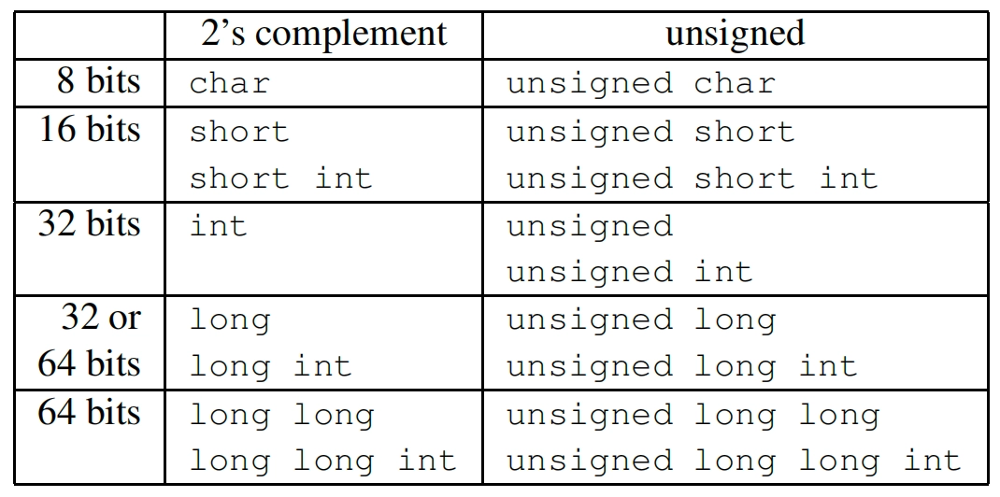
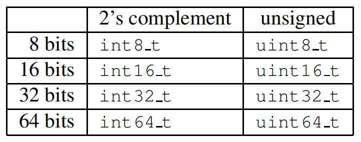

## 数据类型


In Linux, they can be used by including the stdint.h header file in user code or the linux/types.h header file in kernel code.

## inline
[C++ 中的 inline 用法](https://www.runoob.com/w3cnote/cpp-inline-usage.html)

## Static用法
在 C 语言中，static 的字面意思很容易把我们导入歧途，其实它的作用有三条。

## **（1）先来介绍它的第一条也是最重要的一条：隐藏。**

当我们同时编译多个文件时，所有未加 static 前缀的全局变量和函数都具有全局可见性。为理解这句话，我举例来说明。我们要同时编译两个源文件，一个是 a.c，另一个是 main.c。

下面是 a.c 的内容：

### a.c 文件代码

```jsx
char a = 'A'; // global variable
void msg()
{    
	printf("Hello**\\n**");
}
```

下面是 main.c 的内容：

### main.c 文件代码

```jsx
int main(void)
{    
    extern char a;    // extern variable must be declared before use
    printf("%c ", a);
    (void)msg();
    return 0;
}
```

程序的运行结果是：

```
A Hello
```

你可能会问：为什么在 a.c 中定义的全局变量 a 和函数 msg 能在 main.c 中使用？前面说过，所有未加 static 前缀的全局变量和函数都具有全局可见性，其它的源文件也能访问。此例中，a 是全局变量，msg 是函数，并且都没有加 static 前缀，因此对于另外的源文件 main.c 是可见的。

如果加了 static，就会对其它源文件隐藏。例如在 a 和 msg 的定义前加上 static，main.c 就看不到它们了。利用这一特性可以在不同的文件中定义同名函数和同名变量，而不必担心命名冲突。static 可以用作函数和变量的前缀，对于函数来讲，static 的作用仅限于隐藏，而对于变量，static 还有下面两个作用。

## **（2）static 的第二个作用是保持变量内容的持久。**

存储在静态数据区的变量会在程序刚开始运行时就完成初始化，也是唯一的一次初始化。共有两种变量存储在静态存储区：全局变量和 static 变量，只不过和全局变量比起来，static 可以控制变量的可见范围，说到底 static 还是用来隐藏的。虽然这种用法不常见，但我还是举一个例子。

### 实例

```jsx
#include <stdio.h>

int fun(void){
    static int count = 10;    // 事实上此赋值语句从来没有执行过
    return count--;
}

int count = 1;

int main(void)
{    
    printf("global\\t\\tlocal static\\n");
    for(; count <= 10; ++count)
        printf("%d\\t\\t%d\\n", count, fun());    
    
    return 0;
}
```

程序的运行结果是：

```
global          local static

1               10

2               9

3               8

4               7

5               6

6               5

7               4

8               3

9               2

10              1
```

## **（3）static 的第三个作用是默认初始化为 0。**

其实全局变量也具备这一属性，因为全局变量也存储在静态数据区。在静态数据区，内存中所有的字节默认值都是 **0x00**，某些时候这一特点可以减少程序员的工作量。比如初始化一个稀疏矩阵，我们可以一个一个地把所有元素都置 **0**，然后把不是 **0** 的几个元素赋值。如果定义成静态的，就省去了一开始置 **0** 的操作。再比如要把一个字符数组当字符串来用，但又觉得每次在字符数组末尾加 **\0** 太麻烦。如果把字符串定义成静态的，就省去了这个麻烦，因为那里本来就是 **\0** 。

不妨做个小实验验证一下。

### 实例

```jsx
#include <stdio.h>

int a;

int main(void)
{
    int i;
    static char str[10];

    printf("integer: %d;  string: (begin)%s(end)", a, str);

    return 0;
}
```

程序的运行结果如下:

```
integer: 0; string: (begin)(end)
```

最后对 static 的三条作用做一句话总结。首先 static 的最主要功能是隐藏，其次因为 static 变量存放在静态存储区，所以它具备持久性和默认值0。
